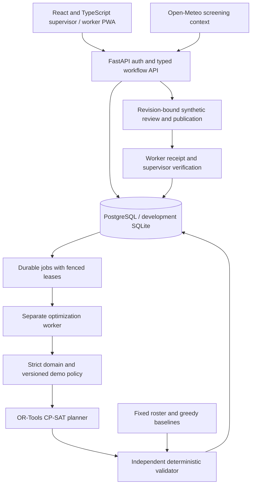

# HeatShield OS: refined technical design

Status: implemented synthetic MVP architecture, updated 2026-11-10. This
document describes the repository's planning core and persistent product
workflow. See [verification](verification.md) for the checks actually completed;
implementation and release verification are tracked separately.

## 1. Product goal and evidence boundary

HeatShield OS turns a work plan and its environmental evidence into a proposed
alternative, explains which modeled constraints changed the plan, and records
receipt and supervisor verification of protective instructions. Its proposed distinction is the
combination of constrained planning, independent checking and intervention
verification. That is a hypothesis to demonstrate, not a claim of exclusive
novelty or proven injury prevention.

The application is a **synthetic-only planning prototype**. A result can pass
the implemented demo policy while still requiring human review. It cannot certify
medical safety, approve actual work, prove preserved wages, or demonstrate a
reduction in heat illness. Demo WBGT thresholds and allowances are explicitly
unreviewed configuration, not clinical or legal recommendations.

Weather information and worksite WBGT have distinct meanings. OSHA describes
workload, clothing and environmental factors relevant to heat assessment; a
weather forecast alone does not establish an individual assignment's safety.
See the [OSHA heat hazards guidance](https://www.osha.gov/heat-exposure/hazards).

## 2. Findings from the original blueprint

| Finding | Design decision |
| --- | --- |
| A one-worker assignment equation does not represent crews or buddies. | Model single-worker, non-preemptive atomic tasks first. Reject or exclude unsupported requirements. |
| A weighted objective can hide tradeoffs or exaggerate optimality. | Keep safety as hard constraints and solve business objectives lexicographically. |
| Reusing candidate filtering as validation can preserve the same bug twice. | Independently reconstruct validity from the original scenario and returned schedule. |
| An idle gap is not necessarily protected recovery. | Reserve explicit, immediately-after-task recovery intervals and site cooling capacity. |
| Productive minutes do not establish wages or contractual protection. | Exclude pay claims until paid attendance and paid recovery have their own model. |
| A forecast, synthetic reading and site measurement have different evidentiary value. | Preserve provenance, quality, timestamps, validity and calibration metadata; keep all first-release scenarios synthetic. |
| A solver's feasibility result is not an operational approval. | Keep solver validity, human synthetic review and demo publication separate; all retain `operational_approval_allowed=false`. |
| Distributed services add deployment and consistency work. | Use a modular monolith, one database and a separate leased optimization worker; the database is the durable queue. |

## 3. Architecture and module boundaries

The stack is Python 3.12+, FastAPI/Pydantic, OR-Tools CP-SAT, SQLAlchemy/Alembic,
PostgreSQL and React/TypeScript/Vite. SQLite supports lightweight local testing
and development. Domain contracts, candidate policy, optimization and independent
validation remain separate from HTTP, identity and persistence. The React client
uses typed API interfaces; OpenAPI is available through the API and CLI.

`api.py` hosts authentication, persistent routes, core planning routes and the
built client. `workflows.py` owns transactional state changes, while `worker.py`
claims durable jobs and computes results outside the claim transaction. No Redis
or Celery service is required. Docker Compose runs API, worker and PostgreSQL.

The optimizer is a proposal generator. The validator is the gate for reporting
whether a proposal meets the modeled constraints. Both may share typed data and
basic timestamp representations, but the validator must not reuse the
optimizer's candidate eligibility filters or trust its objective/status claims.

No external LLM is used. Explanations expose rule findings, policy references
and provenance; fixed English/Hindi/Arabic application templates render worker
messages. The translations are demonstration copy, not clinically validated
guidance. An optional future LLM cannot invent thresholds or alter assignments,
emergency decisions or approvals.

## 4. Planning-core domain contract

| Object | Required meaning |
| --- | --- |
| `Scenario` | Schema version, synthetic marker, site IANA timezone, planning horizon of at most 24 hours, cooling capacity, worker/task/observation inputs, policy, seed and solver budget |
| `Worker` | Stable identifier, skills, availability and acclimatization category; heat-work allowance comes from policy |
| Task | Stable identifier, zone, required skill, release/deadline, duration, outdoor/heat applicability and whether deferral is permitted |
| `Observation` | Zone, WBGT value explicitly in Celsius (`wbgt_c`), observed timestamp, validity interval, source label, quality and calibration reference |
| Policy | Identifier/version, configurable unreviewed demo thresholds, freshness rule, summer restriction, task/worker limits, recovery duration and cooling capacity |
| `Assignment` / `Recovery` | Existing task and worker identifiers and exact start/end, represented as separate interval records |
| `Schedule` | Scenario/policy hashes, assignments, recoveries and explicit deferred-task identifiers; every input task appears exactly once |
| Finding | Stable rule code, affected identifiers and a concrete explanation; separated into violations and review findings |
| Planning result | Solver state, validation findings, objective-stage results, review requirement, hashes, seed, versions and elapsed time |

Models reject unknown properties, malformed identifiers, duplicate input IDs,
naive or out-of-range timestamps (supported UTC years 2000–2100), non-finite environmental values, negative durations/capacity
and unsupported scheduling granularity. The independent validator also checks
cross-references in submitted schedules. Policy numbers are validated as
configuration rather than accepted as arbitrary untyped JSON. Canonical hashes
bind each request snapshot; frozen Pydantic objects alone are not a claim of
deep immutability for nested mappings.

The planning contract does not model crews, task dependencies, travel between
zones, physiological heat dose, payroll or reviewed clinical work/rest tables.
Private synthetic symptom reports are separate workflow records, not medical
history or optimization features. The application does not dispatch responders.

## 5. Time and observation semantics

- Normalize timestamps to UTC-aware instants. Apply calendar restrictions in
  the site's explicit IANA timezone; never infer timezone from a client offset.
- Use half-open intervals `[start, end)`. An assignment ending exactly at a ban
  start does not overlap it; one crossing by one minute does.
- Use a 15-minute planning grid for candidate starts and supported durations.
  Reject unsupported granularity rather than silently round an unsafe interval.
  Restriction overlap checks still operate on exact timestamps.
- Check the entire assignment against every applicable local restriction window,
  including local-date boundaries. The model caps each worker's total heat
  minutes over the complete planning horizon, which is at most 24 hours. This is
  a conservative demonstration bound, not a rolling-window or calendar-day
  occupational exposure rule.
- Recovery starts immediately at task end, consumes worker time, fits within
  availability/horizon and reserves a site cooling place for its full interval.
- Qualifying evidence covers the complete relevant task interval in its zone.
  An observation must satisfy provenance/quality, validity and freshness rules;
  a convenient reading from another zone or a gap in coverage is insufficient.
- Freshness is evaluated against the complete proposed assignment interval and
  observation validity semantics, never an undocumented server clock. The
  contract has no separate replay/evaluation-instant field. Future observations
  in synthetic fixtures must not be presented as already measured real-world
  evidence.

The restriction modeled for the demo is covered outdoor work during the summer
midday window, with exact applicability carried in policy. The
[Abu Dhabi DMT July 2026 notice](https://dmt.gov.ae/en/adm/Media-Centre/News/02Jul2026)
is a source for the reviewed policy work. The prototype is not a legal advice
service and does not automatically infer or grant exemptions.

Source labels include `sensor`, `manual`, `simulated` and `forecast`. Labels and
calibration fields remain visible even in synthetic fixtures. A simulated sensor
record is still synthetic. Forecast data cannot silently become a certified
measurement. Invalid or missing evidence produces findings and blocks the
affected assignment under the demo rules; it does not manufacture a safe value.

## 6. Constrained scheduling model

For each eligible worker/task/start combination, create binary decision variable
`x[w,j,s]`. For each deferrable task create `defer[j]`. Each task must have exactly
one assignment or one explicit deferral. A mandatory task cannot be deferred.

Hard constraints in the current model:

1. Worker qualification, availability and task release/deadline.
2. Non-overlapping work and recovery for each worker.
3. Exact overlap exclusion for applicable summer midday restrictions.
4. Full-interval qualifying WBGT evidence and configured demo exposure threshold.
5. Maximum uninterrupted task duration and acclimatization allowance.
6. Total heat-work minutes per worker over the at-most-24-hour planning horizon.
7. Explicit immediate protected recovery and concurrent site cooling capacity.
8. Complete task accounting without unknown, duplicated or omitted tasks.

This per-task recovery model is deliberately conservative and limited. It does
not claim to implement every rolling-hour occupational work/rest rule. Future
reviewed policies may require rolling windows, workload/clothing categories,
additional facilities or other restrictions before operational use.

Optimize in stages:

1. Minimize the number of permitted deferrals.
2. Minimize a transparent environmental exposure proxy among equally complete
   plans. This is an ordering score, not a medical dose or illness probability.
3. Minimize worker workload spread as an initial fairness proxy.

For each heat task the environmental proxy is
`ceil(10 * maximum qualifying WBGT_C over the task) * task_duration_minutes`.
Full coverage is reconstructed from observation validity and freshness intervals;
the worst qualifying reading is used wherever sources overlap. Workload spread
is maximum minus minimum productive minutes across all listed workers, including
zero-load workers. It is not normalized for skill, available hours or historical
burden; those require a later fairness model.

After an `OPTIMAL` stage, constrain that objective to its optimum before starting
the next stage. If a stage returns `FEASIBLE` because the shared time budget
expires, retain its independently validated incumbent and stop. Do not claim a
lexicographic optimum or run a lower-priority stage that could worsen a higher
priority objective. A zero-result `UNKNOWN` is not proven infeasibility.

Use one shared solve-stage budget of at most five seconds, a recorded random
seed and solver version. This budget does not bound model construction or the
complete HTTP request. Stop candidate generation at 50,000 candidates and return
`MODEL_INVALID` with a diagnostic when that bound would be exceeded. Seeded
execution aids reproducibility; exact runtime
and timeout incumbents can still depend on machine conditions. Consult the
[CP-SAT status documentation](https://developers.google.com/optimization/cp/cp_solver)
and [task scheduling examples](https://developers.google.com/optimization/cp/cp_tasks).

## 7. Independent validation and result states

Validate externally submitted schedules and every optimizer/baseline candidate.
Recompute references, exact duration/window membership, task partition,
qualification, overlapping intervals, restriction applicability, evidence,
planning-horizon heat totals, recovery and cooling occupancy directly from scenario inputs.
Check any supplied scenario/policy identity against canonical input hashes.

Return stable finding codes so tests, API clients and later explanations depend
on meaning rather than exact prose. Distinguish malformed input, a constraint
violation, missing/uncertain evidence, proven infeasibility, a timed-out unknown
result and an internally invalid solver model. An invalid candidate is never
reported as validated merely because the solver called it feasible.

Successful demo validation still returns an explicit human-review requirement.
The workflow can record a synthetic review and publish a demonstration schedule
to authorized worker accounts. Its `APPROVED` and `PUBLISHED` states are product
workflow states, not operational safety authorization. Worker delivery requires
the current revision, validated candidate and matching review; nothing is
automatically approved because a solver completed.

Canonical serialization and SHA-256 input/policy hashes bind results to the
request. Results include schema/policy identity, validator and solver versions,
seed, solver status, stage outcomes and elapsed time. Persistence retains the
complete revision snapshot and policy content as well as hashes. Approval adds
a hash of the exact proposed schedule.

## 8. API, authentication and execution limits

| Endpoint | Contract |
| --- | --- |
| `GET /healthz`, `GET /readyz` | Process health and database/schema access, not occupational readiness |
| `POST /api/v1/auth/login`, `GET /api/v1/auth/me`, `POST /api/v1/auth/logout` | Password login, current server-owned identity and account-wide token revocation |
| `GET/POST /api/v1/scenarios` | Tenant-scoped scenario list and persisted scenario creation |
| `GET/PUT /api/v1/scenarios/{id}` | Current snapshot and revision-checked replacement |
| `POST /api/v1/scenarios/{id}/optimize` | Enqueue current revision; return HTTP 202 and a durable run resource |
| `GET /api/v1/optimization-runs/{id}` | Job, solver, validation and comparison results |
| `POST /api/v1/scenarios/{id}/approve`, `.../publish` | Exact-revision synthetic review and publication by safety role |
| `POST /api/v1/scenarios/{id}/withdraw` | Audited safety-role withdrawal with revision, note and idempotency key |
| `GET /api/v1/scenarios/{id}/compare`, `.../audit` | Computed baseline comparison and linked audit events |
| `GET /api/v1/interventions` | Tenant- and worker-filtered current published instructions |
| `POST /api/v1/interventions/{id}/acknowledge`, `.../verify` | Worker receipt and separate staff implementation verification |
| `GET /api/v1/workers/me/schedule` | Own published assignments, recovery and hold state |
| `POST /api/v1/workers/me/symptoms` | Minimized private synthetic report and urgent hold when applicable |
| `GET /api/v1/workers/holds`, `POST /api/v1/workers/{id}/release-hold` | Minimal staff escalation list and safety-role demo release |
| `GET /api/v1/weather/context` | Optional environmental screening data that cannot admit heat work |
| `GET /api/v1/demo/scenario` | Staff-authenticated synthetic example |
| `GET /api/v1/demo/workspace` | Staff-only tenant-scoped operations aggregation from retained inputs, validated proposals and current workflow state |
| `POST /api/v1/demo/load` | Safety/admin-only additive sample loading in the primary demo organization; unavailable outside demo mode |
| `POST /api/v1/scenarios/validate`, `.../optimize` | Staff-authenticated stateless core tools retained for compatibility |

Roles and tenant/worker bindings are loaded from the database for each bearer
session. Administrator and safety officer can review, publish and release demo
holds; supervisors can plan and verify; workers receive their own published
instructions and report concerns. Roles or actor/tenant IDs supplied in request
payloads or ad hoc browser headers cannot grant authority. JWT expiry,
issuer/audience checks, account activity and token-version revocation apply.

Mutating planning/review/intervention commands use `Idempotency-Key`; the stored
request hash includes actor identity. Identical retries return the original
response; a changed request or actor with the same operation/key conflicts.
Revision-checked transitions return HTTP 409 for stale or conflicting inputs.

Request bodies are capped at 1 MiB. Inputs are limited to 40 workers, 60 tasks,
500 observations and a 24-hour horizon; candidate generation stops at 50,000.
The legacy synchronous optimizer admits two simultaneous calls per API process.
Login attempts have a per-process source-address rate limit. These controls do
not promise a total HTTP latency bound or deployment-wide abuse resistance.
See [security notes](security-notes.md) for actual controls and limitations.

## 9. Persistence, durable execution and intervention workflow

The tracked Alembic migration creates thirteen application tables:
organizations, users, scenarios, scenario revisions, optimization runs,
approvals, interventions, intervention events, private health reports, worker
holds, audit events, outbox and idempotency records. Workers, tasks, observations
and policy packs remain embedded in complete scenario revision snapshots; there
are no separate site/zone/workforce master-data tables yet. The database stores
UTC timestamps and JSON payloads with explicit scenario/policy hashes.

Queue state is durable in `optimization_runs`: `QUEUED -> RUNNING -> COMPLETED`
or `FAILED`. Solver status remains a separate field, so `COMPLETED` can contain
an infeasible or unknown planning outcome. PostgreSQL claims use row locking
with `SKIP LOCKED`; SQLite uses guarded compare-and-set writes. A 120-second
lease and incrementing attempt fence prevent a late worker from overwriting a
reclaimed run. There is no lease heartbeat; expired claims can be retried, with
completion protected by the lease/attempt checks. Computation occurs outside
the short claim transaction. Completion rechecks the retained snapshot,
independent validation and active holds before storing results.

Scenario state tracks the current run and revision through draft, queued,
running, optimized/review-required/failed and reviewed/published states. A stale
worker can retain its historical run result without changing a newer scenario
revision or undoing publication. Database commits precede successful command
responses. Audit and outbox entries are persisted with their transition; no
external email, SMS, emergency dispatch or messaging provider is connected.

Synthetic review requires an authenticated safety-role actor, current scenario
revision/latest run, matching hashes, a feasible candidate and fresh independent
validation. Approval stores input, policy and schedule hashes plus validator
version. Publication repeats these checks atomically. Scenario revision changes
clear approval/publication, and superseded instructions are hidden. Worker reads
recheck candidate integrity and matching approval, including after persistence
tampering. Dependent record lookups retain organization/scenario/revision scope.

Publication also serializes on the organization row and rejects half-open
work/recovery overlap for the same worker across active published scenarios.
The guard remains effective when no login account exists for a planning worker.
An explicit, idempotent safety-role withdrawal hides instructions and allows a
replacement plan while retaining revisions, acknowledgements and audit history.
Recovery capacity is declared per scenario; independently shared cooling pools
across scenarios require a future resource-identity model.

Worker acknowledgement records receipt. Staff verification requires a separate
action and note after acknowledgement. These distinct events are append-only.
Private symptoms stay out of general audit/outbox payloads. Severe reports set a
worker hold, hide affected work and create a minimal staff escalation owned by
the safety role. Publication and symptom transitions serialize on linked worker
identity rows. A safety-role release is explicitly a demonstration action,
never medical clearance. Real emergencies require direct human response.

ORM listeners prevent ordinary application updates/deletes of revision,
approval, event, report and audit rows. They do not stop privileged raw SQL;
deployment permissions, backups and governance remain separate responsibilities.

## 10. Client, weather context and deployment

The React PWA supports scenario import/editing, evidence/findings, run polling,
timeline/comparison, synthetic review/publication, intervention verification,
worker-only schedules, fixed English/Hindi/Arabic instruction text and private
symptom simulation. Staff hold alerts expose action ownership without raw
symptoms. Server authorization remains authoritative even when the UI hides an
action. Errors and stale-revision conflicts remain visible rather than turning
into optimistic success.

The operations dashboard calculates workforce, protected recovery, intervention
progress and follow-up counts from current tenant records. It exposes the
selected shift's retained WBGT curve, scenario states, generic attention queue,
team roster and audit activity. Protection totals require a completed feasible
run, fresh independent validation and matching current approval hashes. Failed,
unknown or tampered published candidates become integrity follow-up items and
are excluded from protective-work totals. Aggregation never includes raw health
symptoms, severity, credentials or another tenant's records. Missing workforce
attributes remain unknown rather than becoming invented qualifications or
acclimatization classifications.

Environment-driven demo startup automatically adds six computed sample stories
covering `DRAFT`, `OPTIMIZED`, `APPROVED`, `PUBLISHED`, `REVIEW_REQUIRED` and
`WITHDRAWN`. Each uses a distinct July 21–26 replay date. Sample computation uses
only designated new fixture inputs; it never drains the durable user queue.
Deterministic sample IDs and additive transactions preserve existing revisions,
acknowledgements, withdrawals, hold releases and customized credentials. Seeded
reviews/events are synthetic walkthrough actions, not actual human approval.
The separate `showcase-worker-07` hold leaves the normal six fixture workers
available for the independent July 15 planning journey.

`HEATSHIELD_DEMO_CONTENT` defaults to enabled through `Settings.from_env` when
`HEATSHIELD_DEMO=true`, and is disabled outside demo mode. Setting it false stops
automatic additions without removing existing data. Direct `Settings(...)`
construction defaults content to false, keeping explicit test/application
configuration free of unexpected sample data. The loading endpoint requires a
safety/admin role and the primary demo organization independently of the
automatic-loading flag.

The service worker caches the public app shell and static assets only. It does
not cache authenticated API responses or queue offline acknowledgements or
other mutations. Session storage and content-security controls are documented
in [security notes](security-notes.md).

Open-Meteo context contains ordinary forecast variables, source attribution,
timestamps and `can_admit_heat_work=false`; it never supplies measured WBGT or
modifies planning evidence. Connector failure returns a bounded unavailable
response while the planning inputs remain unchanged.

The Docker image builds the UI and locked Python environment, runs as a
non-root user, and serves the compiled client with the API. Compose provides
PostgreSQL, separate API/worker containers, migration-before-start behavior,
health/readiness checks and persistent storage. The host port binds to loopback.
Build/runtime configuration exists; successful full-stack deployment is a
separate release verification gate. See [deployment](deployment.md).

## 11. Verification and success criteria

P0 tests cover exact midday/date/timezone boundaries, stale/missing/gapped
evidence, invalid IDs, duplicated/omitted tasks, qualification, availability,
recovery, cooling capacity, acclimatization limits, mandatory-task infeasibility,
tampered outputs and solver timeout states. Product tests add authentication,
tenant/worker boundaries, idempotency, stale/tampered review rejection, private
data isolation, durable recovery and intervention transitions. PostgreSQL tests
exercise the real migration, `SKIP LOCKED`, duplicate claim fencing, restart
durability and publication/revision/hold races. Objective tests use small
scenarios with independently known solutions.

Benchmark fixed-roster, greedy and CP-SAT plans on identical seeded synthetic
scenarios, using the same independent validator. Fixed rosters may be unsafe
references and must be labeled as such. Report violations, completed/deferred
tasks, exposure proxy, workload spread, solver state and elapsed time. Never
replace missing results with invented improvement percentages. The robustness
suite supports up to 100 scenarios across ten declared adversarial families,
retaining hashes, statuses, computed medians/p95 and matched completed-task
exposure-proxy comparisons. Its bootstrap interval describes that synthetic
software score, not a health effect or an independent population sample. The
three-scenario smoke run and a completed 100-scenario run are different evidence
levels; use only artifacts actually recorded in [verification](verification.md).

The usable MVP release gate requires a fresh setup, passing backend/security and
PostgreSQL checks, an exercised browser planning-to-intervention journey, a
working API/worker/database deployment, and retained benchmark evidence. Building
the frontend or container alone does not demonstrate the complete journey.

The populated-workspace refresh passed 223 Python tests, including twelve real
PostgreSQL tests, and five production Chromium journeys. The earlier measured
robustness benchmark and Compose/persistence rehearsal remain baseline evidence;
they are identified separately from this refresh in [verification](verification.md).

## 12. Explicit extensions beyond this MVP

Crews/buddy coverage, precedence/travel, paid attendance/payroll guarantees,
historical fairness and reviewed rolling exposure/work-rest rules remain
extensions. Certified sensors, real employer data, clinical outcome validation,
wearables and an actual field pilot require appropriate policy, measurement,
privacy and evaluation work. They are not claimed as implemented by adding
authentication, a dashboard or demo publication. See [product scope](product-scope.md)
and the [implementation plan](implementation-plan.md).
