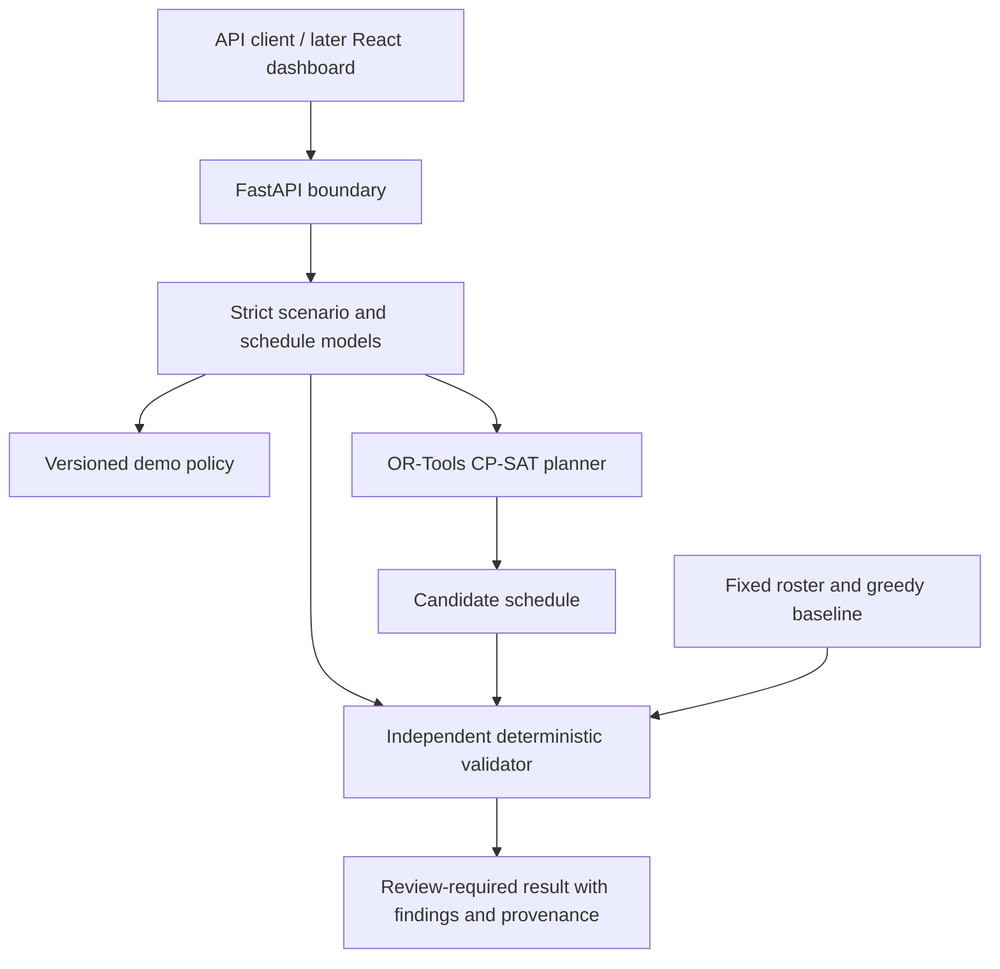

# HeatShield OS: refined technical design

Status: implementation baseline, 2026-11-09. This document refines the shared
project discussion into a bounded, testable first implementation.

## 1. Product goal and evidence boundary

HeatShield OS turns a work plan and its environmental evidence into a proposed
alternative, explains which modeled constraints changed the plan, and eventually
records whether protective actions happened. Its proposed distinction is the
combination of constrained planning, independent checking and intervention
verification. That is a hypothesis to demonstrate, not a claim of exclusive
novelty or proven injury prevention.

The first release is a **synthetic-only planning prototype**. A result can pass
the implemented demo policy while still requiring human review. It cannot certify
medical safety, approve actual work, prove preserved wages, or demonstrate a
reduction in heat illness. Demo WBGT thresholds and allowances are explicitly
unreviewed configuration, not clinical or legal recommendations.

Weather information and worksite WBGT have distinct meanings. OSHA describes
workload, clothing and environmental factors relevant to heat assessment; a
weather forecast alone does not establish an individual assignment's safety.
See the [OSHA heat hazards guidance](https://www.osha.gov/heat-exposure/hazards).

## 2. Findings from the original blueprint

| Finding | Design decision |
| --- | --- |
| A one-worker assignment equation does not represent crews or buddies. | Model single-worker, non-preemptive atomic tasks first. Reject or exclude unsupported requirements. |
| A weighted objective can hide tradeoffs or exaggerate optimality. | Keep safety as hard constraints and solve business objectives lexicographically. |
| Reusing candidate filtering as validation can preserve the same bug twice. | Independently reconstruct validity from the original scenario and returned schedule. |
| An idle gap is not necessarily protected recovery. | Reserve explicit, immediately-after-task recovery intervals and site cooling capacity. |
| Productive minutes do not establish wages or contractual protection. | Exclude pay claims until paid attendance and paid recovery have their own model. |
| A forecast, synthetic reading and site measurement have different evidentiary value. | Preserve provenance, quality, timestamps, validity and calibration metadata; keep all first-release scenarios synthetic. |
| A solver's feasibility result is not an operational approval. | Return review-required demo proposals; omit approve/publish routes. |
| Microservices and durable jobs add setup before the mathematical core is proven. | Begin with a modular monolith and bounded synchronous solving, then add durable orchestration. |

## 3. Architecture and module boundaries

Use Python 3.12+, FastAPI and Pydantic for the first slice. Separate domain
contracts, policy evaluation, optimization, validation and API orchestration.
Keep deterministic planning logic independent of HTTP and persistence.

The optimizer is a proposal generator. The validator is the gate for reporting
whether a proposal meets the modeled constraints. Both may share typed data and
basic timestamp representations, but the validator must not reuse the
optimizer's candidate eligibility filters or trust its objective/status claims.

No external LLM is required. Later explanations may describe existing policy
findings or render approved text; they cannot invent thresholds or alter
assignments, emergency decisions or approvals.

## 4. First-slice domain contract

| Object | Required meaning |
| --- | --- |
| `Scenario` | Synthetic marker, site IANA timezone, planning horizon of at most 24 hours, cooling capacity, worker/task/observation inputs, policy, seed and solver budget |
| `Worker` | Stable identifier, skills, availability and acclimatization category; heat-work allowance comes from policy |
| Task | Stable identifier, zone, required skill, release/deadline, duration, outdoor/heat applicability and whether deferral is permitted |
| `Observation` | Zone, WBGT value explicitly in Celsius (`wbgt_c`), observed timestamp, validity interval, source label, quality and calibration reference |
| Policy | Identifier/version, configurable unreviewed demo thresholds, freshness rule, summer restriction, task/worker limits, recovery duration and cooling capacity |
| `Assignment` / `Recovery` | Existing task and worker identifiers and exact start/end, represented as separate interval records |
| `Schedule` | Scenario/policy hashes, assignments, recoveries and explicit deferred-task identifiers; every input task appears exactly once |
| Finding | Stable rule code, affected identifiers and a concrete explanation; separated into violations and review findings |
| Planning result | Solver state, validation findings, objective-stage results, review requirement, hashes, seed, versions and elapsed time |

Models reject unknown properties, malformed identifiers, duplicate input IDs,
naive or out-of-range timestamps (supported UTC years 2000–2100), non-finite environmental values, negative durations/capacity
and unsupported scheduling granularity. The independent validator also checks
cross-references in submitted schedules. Policy numbers are validated as
configuration rather than accepted as arbitrary untyped JSON. Canonical hashes
bind each request snapshot; frozen Pydantic objects alone are not a claim of
deep immutability for nested mappings.

The initial contract does not model crews, task dependencies, travel between
zones, physiological heat dose, payroll, medical histories, emergency dispatch,
or reviewed clinical work/rest tables. The API and documentation must not imply
those capabilities exist.

## 5. Time and observation semantics

- Normalize timestamps to UTC-aware instants. Apply calendar restrictions in
  the site's explicit IANA timezone; never infer timezone from a client offset.
- Use half-open intervals `[start, end)`. An assignment ending exactly at a ban
  start does not overlap it; one crossing by one minute does.
- Use a 15-minute planning grid for candidate starts and supported durations.
  Reject unsupported granularity rather than silently round an unsafe interval.
  Restriction overlap checks still operate on exact timestamps.
- Check the entire assignment against every applicable local restriction window,
  including local-date boundaries. The first slice caps each worker's total heat
  minutes over the complete planning horizon, which is at most 24 hours. This is
  a conservative demonstration bound, not a rolling-window or calendar-day
  occupational exposure rule.
- Recovery starts immediately at task end, consumes worker time, fits within
  availability/horizon and reserves a site cooling place for its full interval.
- Qualifying evidence covers the complete relevant task interval in its zone.
  An observation must satisfy provenance/quality, validity and freshness rules;
  a convenient reading from another zone or a gap in coverage is insufficient.
- Freshness is evaluated against the complete proposed assignment interval and
  observation validity semantics, never an undocumented server clock. The first
  contract has no separate replay/evaluation-instant field. Future observations
  in synthetic fixtures must not be presented as already measured real-world
  evidence.

The restriction modeled for the demo is covered outdoor work during the summer
midday window, with exact applicability carried in policy. The
[Abu Dhabi DMT July 2026 notice](https://dmt.gov.ae/en/adm/Media-Centre/News/02Jul2026)
is a source for the reviewed policy work. The prototype is not a legal advice
service and does not automatically infer or grant exemptions.

Source labels include `sensor`, `manual`, `simulated` and `forecast`. Labels and
calibration fields remain visible even in synthetic fixtures. A simulated sensor
record is still synthetic. Forecast data cannot silently become a certified
measurement. Invalid or missing evidence produces findings and blocks the
affected assignment under the demo rules; it does not manufacture a safe value.

## 6. Constrained scheduling model

For each eligible worker/task/start combination, create binary decision variable
`x[w,j,s]`. For each deferrable task create `defer[j]`. Each task must have exactly
one assignment or one explicit deferral. A mandatory task cannot be deferred.

Hard constraints in the initial model:

1. Worker qualification, availability and task release/deadline.
2. Non-overlapping work and recovery for each worker.
3. Exact overlap exclusion for applicable summer midday restrictions.
4. Full-interval qualifying WBGT evidence and configured demo exposure threshold.
5. Maximum uninterrupted task duration and acclimatization allowance.
6. Total heat-work minutes per worker over the at-most-24-hour planning horizon.
7. Explicit immediate protected recovery and concurrent site cooling capacity.
8. Complete task accounting without unknown, duplicated or omitted tasks.

This per-task recovery model is deliberately conservative and limited. It does
not claim to implement every rolling-hour occupational work/rest rule. Future
reviewed policies may require rolling windows, workload/clothing categories,
additional facilities or other restrictions before operational use.

Optimize in stages:

1. Minimize the number of permitted deferrals.
2. Minimize a transparent environmental exposure proxy among equally complete
   plans. This is an ordering score, not a medical dose or illness probability.
3. Minimize worker workload spread as an initial fairness proxy.

For each heat task the environmental proxy is
`ceil(10 * maximum qualifying WBGT_C over the task) * task_duration_minutes`.
Full coverage is reconstructed from observation validity and freshness intervals;
the worst qualifying reading is used wherever sources overlap. Workload spread
is maximum minus minimum productive minutes across all listed workers, including
zero-load workers. It is not normalized for skill, available hours or historical
burden; those require a later fairness model.

After an `OPTIMAL` stage, constrain that objective to its optimum before starting
the next stage. If a stage returns `FEASIBLE` because the shared time budget
expires, retain its independently validated incumbent and stop. Do not claim a
lexicographic optimum or run a lower-priority stage that could worsen a higher
priority objective. A zero-result `UNKNOWN` is not proven infeasibility.

Use one shared solve-stage budget of at most five seconds, a recorded random
seed and solver version. This budget does not bound model construction or the
complete HTTP request. Stop candidate generation at 50,000 candidates and return
`MODEL_INVALID` with a diagnostic when that bound would be exceeded. Seeded
execution aids reproducibility; exact runtime
and timeout incumbents can still depend on machine conditions. Consult the
[CP-SAT status documentation](https://developers.google.com/optimization/cp/cp_solver)
and [task scheduling examples](https://developers.google.com/optimization/cp/cp_tasks).

## 7. Independent validation and result states

Validate externally submitted schedules and every optimizer/baseline candidate.
Recompute references, exact duration/window membership, task partition,
qualification, overlapping intervals, restriction applicability, evidence,
planning-horizon heat totals, recovery and cooling occupancy directly from scenario inputs.
Check any supplied scenario/policy identity against canonical input hashes.

Return stable finding codes so tests, API clients and later explanations depend
on meaning rather than exact prose. Distinguish malformed input, a constraint
violation, missing/uncertain evidence, proven infeasibility, a timed-out unknown
result and an internally invalid solver model. An invalid candidate is never
reported as validated merely because the solver called it feasible.

Successful demo validation still returns an explicit human-review requirement.
There is no operational approval state in the first API. No result is silently
published or sent to workers.

Canonical serialization and SHA-256 input/policy hashes bind results to the
request. Include package/contract version, policy identifier/version, validator version,
solver name/version, seed, solver status, stage outcomes and elapsed time. Future
persistence will retain the complete immutable snapshot, not only its hash.

## 8. Initial API and execution limits

| Endpoint | Contract |
| --- | --- |
| `GET /healthz` | Process health; no claim about real sensor or clinical readiness |
| `GET /api/v1/demo/scenario` | Clearly synthetic reproducible example |
| `POST /api/v1/scenarios/validate` | Body `{scenario, schedule}`; independent findings |
| `POST /api/v1/scenarios/optimize` | Body is a scenario; synchronous demo planning with bounded solve stages and candidate count |

The first slice is stateless: no scenario storage, durable job IDs, user identity,
tenant isolation, approval, publishing, real health reporting or messaging. Bind
local development to loopback. Before exposure to real users, add authentication,
request size/concurrency limits, persistence and durable jobs. A solve time limit
does not by itself bound model-construction cost. Initial input limits are 40
workers, 60 tasks, 500 observations and a horizon of at most 24 hours; candidate
generation additionally stops at 50,000. Those limits are not an HTTP latency
service-level guarantee.

The future asynchronous API should create an immutable scenario through
`POST /api/v1/scenarios`, enqueue through
`POST /api/v1/scenarios/{id}/optimize`, and return a run resource retrievable by
ID. Preserve the deterministic core and explicitly version contract changes.

## 9. Persistence and intervention workflow migration

Add PostgreSQL, SQLAlchemy and Alembic after the planning contract stabilizes.
Group tables around organizations/sites/workers, immutable scenario snapshots,
versioned policies, optimization runs, schedules/revisions, approvals,
interventions/events and audit events. Add private health records only with a
separate authorized access model and data minimization review.

Run optimization in a separate worker with a durable queue. Persist transitions
and results so process restarts cannot lose accepted work. Use idempotency keys
for commands and an outbox for externally delivered notifications.

Approval requires an authenticated safety-role actor and an atomic check of the
scenario hash, policy hash, schedule revision and current validation. Changes
invalidate prior approval. Publishing repeats the check. Worker acknowledgement
records receipt; supervisor verification records implementation as a separate
append-only event. Neither is inferred from a message being sent.

## 10. Verification and success criteria

P0 tests cover exact midday/date/timezone boundaries, stale/missing/gapped
evidence, invalid IDs, duplicated/omitted tasks, qualification, availability,
recovery, cooling capacity, acclimatization limits, mandatory-task infeasibility,
tampered outputs and solver timeout states. API tests verify strict input
validation and synthetic-only scope. Objective tests use small scenarios with
independently known solutions.

Benchmark fixed-roster, greedy and CP-SAT plans on identical seeded synthetic
scenarios, using the same independent validator. Fixed rosters may be unsafe
references and must be labeled as such. Report violations, completed/deferred
tasks, exposure proxy, workload spread, solver state and elapsed time. Never
replace missing results with invented improvement percentages. A smaller fixture
run is a smoke benchmark, not the later 100–300-scenario evaluation.

The immediate milestone is complete when a fresh checkout can run tests, serve
the API, retrieve a demo scenario, generate a proposal and independently verify
it, while clearly reporting synthetic evidence and remaining limitations.
