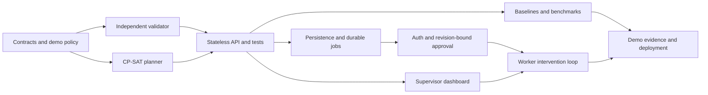

# HeatShield OS: prioritized implementation plan

Prepared 2026-11-09; implementation status updated 2026-11-10. See
[the refined design](design.md) for the current architecture and
[verification](verification.md) for executed checks.

The shared discussion names **November 20, 2026** as the prototype submission
deadline. That date has not been independently verified here. The plan below
uses it as a working target; estimates are focused engineering time, not a
guarantee of completion by a competition organizer's deadline.

## 1. Priority and dependency order

P0 and the P1 synthetic product workflow are implemented. The latest complete
Python run passed **200 tests**, including **11 real PostgreSQL tests**; Ruff
passed across 44 Python files. The final production UI build and four Chromium workflow tests passed, including
audited withdrawal and a private-report/stop-work response. The full Compose
journey and persistence rehearsal passed; the final-source conflict/withdrawal container delta passed too. The source
and remote CI status are recorded in the release gates below.

The 100-scenario robustness run also completed: ten families with ten scenarios
each, 55 validated proposals (22 `OPTIMAL`, 33 `FEASIBLE`), 45 `INFEASIBLE`
outcomes and zero invalid returned proposals. Median runtime was 0.346 seconds
and p95 2.032 seconds in that recorded run. These are software-demo results,
not clinical or population-effect evidence. The retained
[summary](evidence/benchmark-summary.json) and
[compressed full output](evidence/benchmark-robustness-100.json.gz) support them.

MVP completion means the usable synthetic workflow plus packaging and evidence.
Broader crew, payroll, rolling-policy and field-pilot extensions remain explicit
roadmap work, not implied features of a completed synthetic MVP.

## 2. P0: first executable planning slice

Original planning estimate: approximately 2–3 focused engineering days. This
milestone is implemented and covered by domain, solver, validator and API tests.

### A. Contracts, fixtures and review baseline — 0.5 day

- [x] Review the original blueprint and record refined technical boundaries.
- [x] Write a prioritized plan with acceptance gates and a scope cut line.
- [x] Scaffold a Python 3.12 FastAPI package and reproducible development setup.
- [x] Add strict Pydantic models with aware UTC timestamps, explicit site
  timezone, synthetic marker, typed policy and provenance; bound the horizon to
  at most 24 hours.
- [x] Reject duplicate IDs, unknown references, invalid intervals, unsupported
  grid alignment, unbounded inputs and non-finite numbers.
- [x] Supply an unreviewed demo policy and a reproducible synthetic scenario.

Acceptance: malformed or non-synthetic scenarios fail clearly; fixtures disclose
their source labels and never assert real-world approval.

### B. Independent validator — 0.5–0.75 day

- [x] Validate complete exactly-once task accounting and known references.
- [x] Check qualifications, availability, task duration and task windows.
- [x] Check exact half-open summer restriction overlap in the site timezone.
- [x] Check full-interval environmental coverage, quality and freshness.
- [x] Check uninterrupted-task and acclimatization limits and total heat minutes
  over the planning horizon. This is a conservative demonstration bound, not a
  calendar-day or rolling-window occupational rule.
- [x] Check non-overlapping work/recovery, immediate recovery and site cooling
  capacity.
- [x] Produce stable rule codes and concrete task/worker findings.
- [x] Bind validation to canonical scenario/policy hashes.

Acceptance: deliberate schedule corruption is rejected without relying on
optimizer candidate filters. Exact boundary and cooling contention examples
have independently expected results.

### C. CP-SAT optimizer — 0.5–0.75 day

- [x] Generate eligible single-worker, non-preemptive task/start candidates.
- [x] Implement all initial hard constraints, including recovery resources.
- [x] Account for every task through one assignment or permitted deferral.
- [x] Solve deferrals, environmental proxy and workload spread lexicographically.
- [x] Lock only proven optimal stages; stop with a feasible incumbent on timeout.
- [x] Distinguish `OPTIMAL`, `FEASIBLE`, `INFEASIBLE`, `UNKNOWN` and model errors.
- [x] Enforce a shared solve-stage budget of at most five seconds and record seed,
  solver version, stage results and elapsed time.
- [x] Bound candidate generation at 50,000 and return `MODEL_INVALID` with a
  diagnostic when exceeded; do not describe the solve budget as an overall
  HTTP/model-construction timeout.
- [x] Independently validate every returned candidate and fail closed on defects.

Acceptance: impossible mandatory tasks cannot disappear or become deferred;
small known-optimum cases verify objective order; a timed-out feasible result
never claims a lexicographic optimum.

### D. API, baselines and verification — 0.5–1 day

- [x] Implement `GET /healthz` and `GET /api/v1/demo/scenario`.
- [x] Implement `POST /api/v1/scenarios/validate` with `{scenario, schedule}`.
- [x] Implement synchronous `POST /api/v1/scenarios/optimize` with bounded solve
  stages and candidate generation.
- [x] Return explicit review requirements, hashes, findings and solver metadata.
- [x] Add fixed-roster and feasible greedy baseline generation.
- [x] Add a seeded benchmark CLI reporting computed results for identical inputs.
- [x] Add adversarial/domain/API tests and a CI job running required checks.
- [x] Document local startup, requests, verification and known exclusions.

Acceptance: fresh-install test run passes; demo request returns a proposal that
the separate validation route can check; benchmark numbers come from execution.

## 3. P1: persistent product workflow

Original planning estimate: approximately 3–4 focused engineering days. All
features below have code and targeted verification. Final browser/deployment
release gates remain separate; a checked implementation task does not imply
clinical approval or completion of every broader blueprint extension.

### E. Persistence and durable jobs — 1 day

- [x] Add PostgreSQL, SQLAlchemy models and an explicit Alembic migration for
  thirteen application tables; retain SQLite development support.
- [x] Persist complete immutable scenario/policy revisions and exact result hashes.
- [x] Persist optimization run state, metadata, findings, comparisons and audit events.
- [x] Add a separate database-backed worker with leased claims, attempt fencing,
  crash recovery and idempotency keys. Redis/Celery are not required.
- [x] Introduce scenario creation and run-resource endpoints, documenting changes
  from the initial stateless API.

Acceptance: accepted work survives process restarts; retries do not duplicate
commands; a run can be reproduced from its retained snapshot. Real PostgreSQL
tests cover migration round trips, `SKIP LOCKED`, duplicate claims, lease
reclamation, restart durability and conflicting publication transitions.

### F. Identity, approval and publishing — 0.75–1 day

- [x] Add authenticated roles, JWT expiry/revocation and tenant-scoped access.
- [x] Restrict synthetic policy/scenario revision, review and worker data by role;
  derive tenant, actor and worker identity from the authenticated account.
- [x] Bind synthetic review to input/policy/schedule hashes and revision.
- [x] Revalidate atomically at review/publication, invalidate on revision changes,
  and reject or hide tampered and superseded candidates.
- [x] Add audit records, request/concurrency limits and actor-bound idempotency.
- [x] Block conflicting workers across active published plans under a tenant lock;
  provide audited withdrawal and replacement without deleting history.

Acceptance: cross-tenant access fails; stale approval cannot publish a changed
plan; worker and private-report boundaries are enforced by the server. The
independent product security suite passed 23 tests. The authentication suite
passed 17 tests. See [security notes](security-notes.md) for controls and limits.

### G. Supervisor dashboard — 1–1.5 days

- [x] Build a React/TypeScript scenario and schedule view from actual API data.
- [x] Show original findings, proposal, explicit deferrals and recovery resources.
- [x] Show provenance/uncertainty, exact policy references and computed metrics.
- [x] Support durable run polling and role-bound synthetic review/publication.
- [x] Add Chromium browser coverage of the planning/intervention journey.
- [x] Build the production UI bundle with TypeScript and Vite checks.

Acceptance: users can trace a changed assignment to its rule/data evidence, and
the UI preserves solver uncertainty and synthetic labels. Four final production-bundle browser tests passed. The journey includes
withdrawal and confirmation that withdrawn plans disappear from worker views.

### H. Intervention loop — 0.75–1 day

- [x] Add worker-only published schedules and fixed English/Hindi/Arabic
  demonstration templates, without a clinical translation-review claim.
- [x] Record worker acknowledgement separately from staff verification.
- [x] Add append-only intervention transitions and minimal staff escalation ownership.
- [x] Add private synthetic reports, active holds, worker-view suppression and a
  safety-role demo-release action that explicitly is not medical clearance.
- [x] Add an explicit severe-symptom human-response workflow; do not claim to
  dispatch emergency services.

Acceptance: a sent or acknowledged instruction is never presented as a verified
completed protective action. Raw symptom/severity details remain outside general
audit/outbox payloads. Workflow and worker suites passed 31 tests; PostgreSQL
tests also serialize symptom/publication races. Real health-data use remains
outside this release.

## 4. P2: evidence and delivery implemented for the MVP

The delivery/evidence subset is implemented; the broader modeling extensions
below remain outside the synthetic MVP completion target.

- [x] Execute 100 seeded scenarios across ten adversarial families; retain paired
  computed metrics, feasible coverage, violations, solver states and runtime
  distributions with transparent synthetic-sampling limitations.
- [x] Add optional attributed weather screening context, explicitly excluded
  from WBGT evidence and work-admission decisions.
- [x] Add fixed multilingual application templates; use no LLM in policy or
  scheduling decisions.
- [x] Package a multi-stage Docker image, API/worker/PostgreSQL Compose stack,
  health/readiness checks, migrations and reproducible synthetic fixtures.
- [x] Write [deployment instructions](deployment.md),
  [product scope](product-scope.md) and a [three-minute demo script](demo-script.md).

Acceptance: reported results come from retained runs, clear baselines and
declared scenario families. A successful image build does not replace the
full-stack deployment and restart rehearsal below.

### Broader constraints and field-pilot extensions — intentionally not implemented

- [ ] Model crews/buddy coverage, task precedence and travel where required.
- [ ] Add reviewed rolling work/rest policies and richer workload/clothing rules.
- [ ] Model paid attendance/recovery before claiming wage protection.
- [ ] Add historical fairness across comparable eligible workers.
- [ ] Integrate certified live measurements and real employer systems through a
  reviewed data-quality and operational policy process.
- [ ] Conduct appropriate clinical/field evaluation before making health-outcome
  or real-work safety claims.

These items require new domain contracts and evidence. Keep them open rather
than marking the entire original blueprint implemented. Optional wearables,
biometrics, custom medical classifiers, RAG/LLM and external messaging are also
outside the present release.

## 5. Remaining release gates and working calendar

- [x] Complete the Python suite with a real PostgreSQL integration target:
  200 passed, including eleven PostgreSQL checks.
- [x] Complete Ruff lint/format checks: 44 Python files passed.
- [x] Build the TypeScript/Vite production client and pass four final
  Chromium product journeys.
- [x] Complete and retain the 100-scenario robustness benchmark.
- [x] Build the Docker application image successfully.
- [x] Finish final production-bundle browser checks after the last display changes: four passed.
- [x] Complete API/worker/PostgreSQL Compose journey and persistent restart rehearsal.
- [x] Recheck the final-source container conflict/withdrawal delta.
- [x] Reconcile the final verification record and publish source/evidence to PR #1.
- [x] Exercise remote backend, browser and container checks; stop background test
  processes explicitly before dependency-cache cleanup. The current PR checks
  remain authoritative for the final source revision.

The calendar below preserves the original dependency plan. Much of its
implementation landed by November 10; these rows are working targets, not a
claim that work was executed on each future date. The discussion's November 20
submission date still requires independent organizer confirmation.

| Working dates | Deliverable | Exit gate |
| --- | --- | --- |
| Nov 9–12 | Refined design and P0 planning API | Independent validator, solver, demo, adversarial tests and benchmark smoke run |
| Nov 13–14 | Persistence, durable runs, identity and approval | Restart-safe runs and revision-bound approval |
| Nov 15–16 | Supervisor dashboard and expanded benchmark | Tested user journey and computed comparison evidence |
| Nov 17 | Worker intervention loop | Receipt and implementation verification remain separate |
| Nov 18 | Robustness, security and selected P2 constraints | No unresolved critical modeled-constraint failure |
| Nov 19 | Deployment rehearsal, docs and demo recording | Fresh setup and full synthetic demo reproducible |
| Nov 20 | Submission packaging, if confirmed | Verified submission requirements and retained artifacts |

Use remaining time for the release gates, reproducibility and submission review.
Do not expand the domain model simply to check every original research item
without the policy and test work it requires.

## 6. Scope cut line and release decision

The current completion target retains P0 correctness, the independent validator,
the full synthetic P1 workflow, benchmark evidence and delivery packaging.
Optional AI/RAG, wearables, live sensors, custom medical classifiers and richer
constraint models remain extensions. Never
cut task accounting, uncertainty labels, exact restriction checks or the
distinction between a feasible proposal and an approved real-world plan.

A complete competition demo can remain synthetic and local. Real workplace operation
requires qualified policy review, applicable legal verification, certified or
otherwise appropriate measurement integrations, secure real-user workflow and
field evaluation beyond this prototype plan.
