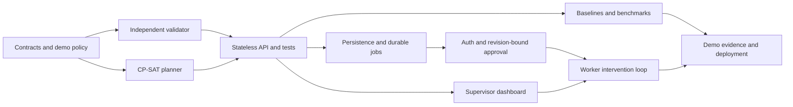

# HeatShield OS: prioritized implementation plan

Prepared 2026-11-09. See [the refined design](design.md) for contracts, safety
boundaries and architecture decisions.

The shared discussion names **November 20, 2026** as the prototype submission
deadline. That date has not been independently verified here. The plan below
uses it as a working target; estimates are focused engineering time, not a
guarantee of completion by a competition organizer's deadline.

## 1. Priority and dependency order

P0 is the implemented and tested mathematical/API foundation.
Verification: 95 tests passed; see [the verification record](verification.md). P1 adds product
workflow and persistence. P2 broadens the constraint model and adds optional
presentation capabilities. A missing P1/P2 feature must remain visible in scope
documentation; it cannot become an implied P0 guarantee.

## 2. P0: first executable planning slice

Target effort: approximately 2–3 focused engineering days. These checkboxes
describe work to complete and should be marked only after code and verification
exist.

### A. Contracts, fixtures and review baseline — 0.5 day

- [x] Review the original blueprint and record refined technical boundaries.
- [x] Write a prioritized plan with acceptance gates and a scope cut line.
- [x] Scaffold a Python 3.12 FastAPI package and reproducible development setup.
- [x] Add strict Pydantic models with aware UTC timestamps, explicit site
  timezone, synthetic marker, typed policy and provenance; bound the horizon to
  at most 24 hours.
- [x] Reject duplicate IDs, unknown references, invalid intervals, unsupported
  grid alignment, unbounded inputs and non-finite numbers.
- [x] Supply an unreviewed demo policy and a reproducible synthetic scenario.

Acceptance: malformed or non-synthetic scenarios fail clearly; fixtures disclose
their source labels and never assert real-world approval.

### B. Independent validator — 0.5–0.75 day

- [x] Validate complete exactly-once task accounting and known references.
- [x] Check qualifications, availability, task duration and task windows.
- [x] Check exact half-open summer restriction overlap in the site timezone.
- [x] Check full-interval environmental coverage, quality and freshness.
- [x] Check uninterrupted-task and acclimatization limits and total heat minutes
  over the planning horizon. This is a conservative demonstration bound, not a
  calendar-day or rolling-window occupational rule.
- [x] Check non-overlapping work/recovery, immediate recovery and site cooling
  capacity.
- [x] Produce stable rule codes and concrete task/worker findings.
- [x] Bind validation to canonical scenario/policy hashes.

Acceptance: deliberate schedule corruption is rejected without relying on
optimizer candidate filters. Exact boundary and cooling contention examples
have independently expected results.

### C. CP-SAT optimizer — 0.5–0.75 day

- [x] Generate eligible single-worker, non-preemptive task/start candidates.
- [x] Implement all initial hard constraints, including recovery resources.
- [x] Account for every task through one assignment or permitted deferral.
- [x] Solve deferrals, environmental proxy and workload spread lexicographically.
- [x] Lock only proven optimal stages; stop with a feasible incumbent on timeout.
- [x] Distinguish `OPTIMAL`, `FEASIBLE`, `INFEASIBLE`, `UNKNOWN` and model errors.
- [x] Enforce a shared solve-stage budget of at most five seconds and record seed,
  solver version, stage results and elapsed time.
- [x] Bound candidate generation at 50,000 and return `MODEL_INVALID` with a
  diagnostic when exceeded; do not describe the solve budget as an overall
  HTTP/model-construction timeout.
- [x] Independently validate every returned candidate and fail closed on defects.

Acceptance: impossible mandatory tasks cannot disappear or become deferred;
small known-optimum cases verify objective order; a timed-out feasible result
never claims a lexicographic optimum.

### D. API, baselines and verification — 0.5–1 day

- [x] Implement `GET /healthz` and `GET /api/v1/demo/scenario`.
- [x] Implement `POST /api/v1/scenarios/validate` with `{scenario, schedule}`.
- [x] Implement synchronous `POST /api/v1/scenarios/optimize` with bounded solve
  stages and candidate generation.
- [x] Return explicit review requirements, hashes, findings and solver metadata.
- [x] Add fixed-roster and feasible greedy baseline generation.
- [x] Add a seeded benchmark CLI reporting computed results for identical inputs.
- [x] Add adversarial/domain/API tests and a CI job running required checks.
- [x] Document local startup, requests, verification and known exclusions.

Acceptance: fresh-install test run passes; demo request returns a proposal that
the separate validation route can check; benchmark numbers come from execution.

## 3. P1: persistent product workflow

Target effort: approximately 3–4 focused engineering days, after P0 contracts
stabilize. This work can partly parallelize with the supervisor dashboard.

### E. Persistence and durable jobs — 1 day

- [ ] Add PostgreSQL, SQLAlchemy models and Alembic migrations.
- [ ] Persist immutable scenario/policy snapshots and schedule revisions.
- [ ] Persist optimization run state, metadata, findings and audit events.
- [ ] Add a separate durable worker and queue, retry policy and idempotency keys.
- [ ] Introduce scenario creation and run-resource endpoints, documenting changes
  from the initial stateless API.

Acceptance: accepted work survives process restarts; retries do not duplicate
commands; a run can be reproduced from its retained snapshot.

### F. Identity, approval and publishing — 0.75–1 day

- [ ] Add authenticated roles and tenant-scoped database access.
- [ ] Restrict policy changes, approvals and worker/private data by role.
- [ ] Bind approval to input/policy hashes and schedule revision.
- [ ] Revalidate atomically at approval and publishing; invalidate on changes.
- [ ] Add audit records, request/concurrency limits and command idempotency.

Acceptance: cross-tenant access fails; stale approval cannot publish a changed
plan; no real-user deployment proceeds without these controls.

### G. Supervisor dashboard — 1–1.5 days

- [ ] Build a React/TypeScript scenario and schedule view from actual API data.
- [ ] Show original findings, proposal, explicit deferrals and recovery resources.
- [ ] Show provenance/uncertainty, exact policy references and computed metrics.
- [ ] Support planning-run status and human-review workflow after F is complete.
- [ ] Add browser coverage of the core planning journey.

Acceptance: users can trace a changed assignment to its rule/data evidence, and
the UI preserves solver uncertainty and synthetic labels.

### H. Intervention loop — 0.75–1 day

- [ ] Add worker schedule/instruction view and approved message templates.
- [ ] Record acknowledgement separately from supervisor verification.
- [ ] Add append-only intervention transitions and escalation ownership.
- [ ] Add an explicit severe-symptom human-response workflow; do not claim to
  dispatch emergency services.

Acceptance: a sent or acknowledged instruction is never presented as a verified
completed protective action. Health information has an authorized, minimized
storage/access path before real-worker use.

## 4. P2: broader constraints and competition evidence

Target effort: 1–2 days for selected items. Choose based on remaining time and
policy review; do not rush all items into the first model.

- [ ] Model crews/buddy coverage, task precedence and travel where required.
- [ ] Add reviewed rolling work/rest policies and richer workload/clothing rules.
- [ ] Model paid attendance/recovery before claiming wage protection.
- [ ] Add historical fairness across comparable eligible workers.
- [ ] Expand to 100–300 seeded synthetic scenarios and report paired outcomes,
  feasible coverage, violations, runtime distribution and solver optimality.
- [ ] Add optional weather ingestion with explicit screening-only provenance.
- [ ] Add multilingual approved templates; keep optional LLM explanations out of
  policy and scheduling decisions.
- [ ] Prepare deployment, a reproducible demo seed and a three-minute demo script.

Acceptance: reported performance comes from retained runs and clear baselines;
all broadened constraints have adversarial verification and documented limits.

## 5. Working calendar to the discussion's November 20 target

| Working dates | Deliverable | Exit gate |
| --- | --- | --- |
| Nov 9–12 | Refined design and P0 planning API | Independent validator, solver, demo, adversarial tests and benchmark smoke run |
| Nov 13–14 | Persistence, durable runs, identity and approval | Restart-safe runs and revision-bound approval |
| Nov 15–16 | Supervisor dashboard and expanded benchmark | Tested user journey and computed comparison evidence |
| Nov 17 | Worker intervention loop | Receipt and implementation verification remain separate |
| Nov 18 | Robustness, security and selected P2 constraints | No unresolved critical modeled-constraint failure |
| Nov 19 | Deployment rehearsal, docs and demo recording | Fresh setup and full synthetic demo reproducible |
| Nov 20 | Submission packaging, if confirmed | Verified submission requirements and retained artifacts |

This is dependency-aware scope planning, not a claim that the entire blueprint
can be completed safely by parallelizing every row. Reserve time for integration
and cut optional features when a prior gate is not met.

## 6. Scope cut line and release decision

If time is short, retain P0 correctness, the independent validator, benchmark
evidence and a minimal supervisor demonstration. Cut optional AI/RAG, wearables,
live sensors, custom medical classifiers and rich visual polish first. Never
cut task accounting, uncertainty labels, exact restriction checks or the
distinction between a feasible proposal and an approved real-world plan.

A competition demo may remain synthetic and local. Real workplace operation
requires qualified policy review, applicable legal verification, certified or
otherwise appropriate measurement integrations, secure real-user workflow and
field evaluation beyond this prototype plan.
